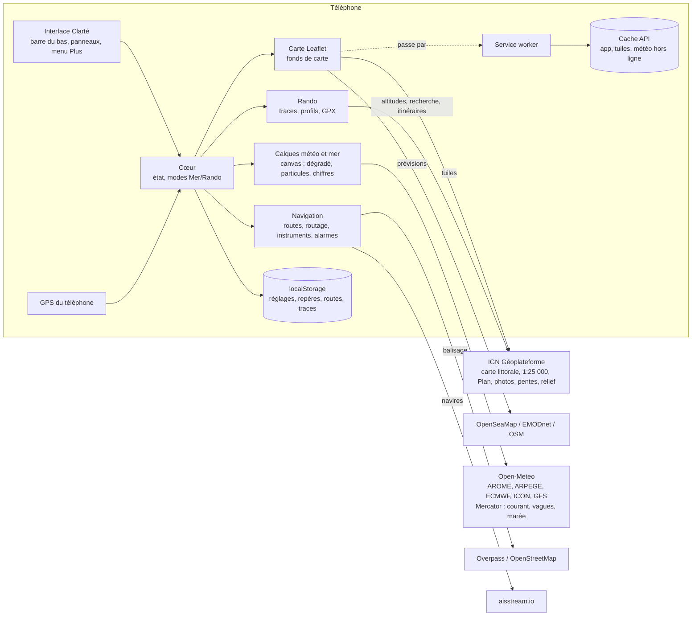
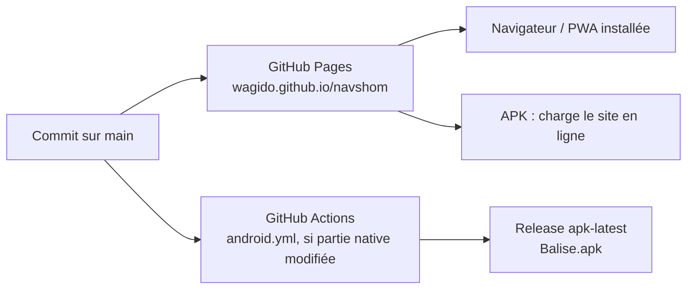

# Balise — Note de conception

> « De la mer aux sommets ». Application de Capitaine BoBo (anciennement « Nav SHOM »).

> Statut : version 2026.11.16-z · Dernière mise à jour : 16 novembre 2026

## 1. Résumé

Balise est une application de navigation gratuite pour téléphone, avec deux modes :

- **Mer** (le cœur du produit) :
  - carte marine (carte littorale IGN-SHOM) et position GPS du bateau ;
  - vent, courant, vagues et houle animés sur la carte, avec une barre de temps ;
  - marées officielles du SHOM ;
  - routage météo avec la polaire de son bateau (604 modèles ORC, avec ou sans spi) ;
  - écran instruments avec performance polaire ;
  - alarmes : mouillage, écart de route, collision AIS ;
  - infos des bouées et des feux ;
  - bulletins officiels ;
  - cartes et météo hors ligne.
- **Rando** :
  - cartes IGN au 1:25 000, ombrage du relief, carte des pentes de plus de 30° ;
  - neige et iso 0 °C ;
  - itinéraires sur sentiers, traces, profils et mode course ;
  - import et export GPX ;
  - **vue 3D** du relief (photo, carte IGN ou pentes drapées, traces et repères).

C'est une **application web installable** (PWA) : un seul code HTML/JS publié sur GitHub Pages. Elle tourne dans le navigateur, s'installe sur l'écran d'accueil, ou s'emballe dans un **APK Android** (Capacitor). **Il n'y a pas de serveur à nous** : le téléphone interroge directement des services publics gratuits.

## 2. Objectifs et contraintes

| Objectif | Conséquence technique |
|---|---|
| Gratuit, sans abonnement ni pub | Uniquement des données ouvertes ; aucun backend |
| Utilisable en mer sans réseau | Service worker, cache des tuiles, zones téléchargées avec 3 jours de météo |
| Mise à jour sans passer par un store | L'APK charge le site en ligne ; le site est la source unique |
| Un seul développeur, itérations rapides | Un seul fichier applicatif, aucune étape de build côté web |
| Respect des fournisseurs de données | Pas de contournement d'accès (refus d'usurper le *referer* SHOM) ; quotas Open-Meteo économisés ; pas de téléchargement en masse des tuiles OpenStreetMap |
| Lisible en mer, au soleil, en mouvement | Style « Clarté » : fond blanc, gros chiffres, peu de boutons, mode nuit rouge |

## 3. Pile technique

| Couche | Choix | Pourquoi |
|---|---|---|
| Carte | **Leaflet 1.9.4** (embarqué dans `lib/`) | Léger, éprouvé, fonctionne hors ligne |
| Interface | HTML + CSS + JavaScript « vanilla » | Pas de framework, pas de build, démarrage instantané |
| Vue 3D (Rando) | **Three.js r147** (embarqué dans `lib/`, chargé à la demande) | Version non-module : pas de build ; OrbitControls pour les gestes |
| Rendu météo | **Canvas 2D** (dégradé, particules, chiffres) | Fluide sur mobile, sans dépendance |
| Police | **Inter** (embarquée, licence OFL) | Lisible, chiffres tabulaires, identique partout |
| Hors ligne | **Service worker** (`sw.js`) + Cache API | Standard web |
| Hébergement | **GitHub Pages** | Gratuit, HTTPS (obligatoire pour le GPS) |
| App Android | **Capacitor 6** (WebView), construit par **GitHub Actions** | APK sans Android Studio |

## 4. Organisation du dépôt

```
navshom/
├── index.html              # toute l'application (≈ 2 900 lignes : HTML, CSS, JS)
├── sw.js                   # service worker : cache de l'app et des tuiles
├── manifest.webmanifest    # métadonnées PWA (nom, icônes, couleurs)
├── icon.svg, icon-*.png    # icônes
├── lib/
│   ├── leaflet.js / .css   # bibliothèque de carte
│   ├── landmask.png        # masque terre/mer France (GLOBE ~1 km)
│   ├── polars-orc.json     # 604 polaires de série (certificats ORC), chargé à la demande
│   ├── three.min.js        # Three.js r147 (MIT), chargé à l'ouverture de la vue 3D
│   ├── three-orbit.js      # OrbitControls (gestes de la vue 3D)
│   ├── LICENSE-three.txt
│   └── fonts/              # police Inter (woff2) + licence
├── tools-check.js          # contrôle automatique de mise en page (Playwright)
├── android-debug.keystore  # clé fixe de signature de l'APK
├── .github/workflows/
│   └── android.yml         # construction et publication de l'APK
└── docs/ARCHITECTURE.md    # ce document
```

Choix assumé : **un seul `index.html`**. Si l'app grossit encore, le découpage naturel suit les modules du §5.

## 5. Architecture applicative



### Modules (sections de `index.html`)

| Module | Rôle | Points clés |
|---|---|---|
| **Carte** | Fonds de carte, zoom, échelle, calage | Un fond par mode, mémorisé ; contrôle du calage par photo aérienne ; échelle orange au-delà du détail natif |
| **GPS** | Position, vitesse, cap, trace | `watchPosition` (navigateur) ou géolocalisation native en arrière-plan (APK) ; vitesse et cap recalculés si absents |
| **Point / repères / MOB** | Toucher la carte, repères, « Aller ici », homme à la mer | En Mer, le panneau du point affiche aussi le **balisage à proximité** |
| **Mesure** | Route multi-segments | Mer : milles et temps ; Rando : km, profil IGN, temps de marche, suivi des sentiers |
| **Panneau Météo** | Calque animé + barre de temps + tableau | Voir « Panneau Météo » ci-dessous |
| **7 jours** | Prévision quotidienne et comparaison des 5 modèles | Volet séparé, ouvert par le bouton « 7 jours » |
| **Courant et marée** | Courbe marée + courant au point touché ; vignette SHOM du port | Marée officielle SHOM pour 60 ports |
| **Routes** | Waypoints, navigation, écart de route, heure d'arrivée | Alarme si écart de route supérieur à 0,1 mille |
| **Routage** | Route la plus rapide | Grille et Dijkstra dépendant du temps sur les cellules de mer ; vent et courant prévus ; polaire (§5.3) |
| **Instruments** | Écran plein de gros chiffres | Voir §5.4 |
| **Mouillage** | Cercle d'évitage et alarme | Sirène deux tons, son débloqué au premier contact, notification Android prioritaire répétée, bouton « Tester » |
| **AIS** | Navires autour (internet) | WebSocket aisstream.io, clé gratuite de l'utilisateur ; point de rapprochement (CPA/TCPA) et alerte à moins de 0,5 mille dans les 15 min |
| **Hors ligne** | Zones téléchargées | Voir §7 |
| **Rando** | Traces, profils, itinéraires IGN, GPX, mode course | Pentes, neige, iso 0 °C, ombrage, photos aériennes au zoom maximal |
| **Vue 3D** | Relief plein écran (bouton « 3D », Rando) | Voir §5.6 |
| **Menu Plus** | Tuiles d'accès rapide + rubriques repliables | Instruments, Routage, Hors ligne, AIS, Bulletins, Mode nuit ; Routes, Repères, Réglages, Sauvegarde, À propos |
| **Mise à jour** | Bandeau « Nouvelle version disponible » | §8 |

### 5.1 Panneau Météo (bouton Météo, et Courant en Mer)

- **Replié** : titre (couche, heure, valeur au bateau ou au centre de la carte) et **barre de temps** façon Windy, qu'on fait glisser pour animer la carte heure par heure.
- **Déplié** :
  - en Mer, **pastilles de couche** (vent, rafales, courant, vagues, houle, température, pression…) ;
  - modèle météo, chiffres, animation, « 7 jours » ;
  - lever et coucher du soleil ;
  - **tableau heure par heure**. Sa hauteur est limitée à environ 30 % de l'écran et la ligne des heures reste fixe. En Mer, le vent, les vagues et le courant sont en tête. Toucher le nom d'une ligne affiche cette couche sur la carte, ce qui est la seule façon de choisir la couche en Rando.
- « Météo ici » (toucher un point) charge le tableau à ce point.
- En Mer, la couche Courant affiche l'avertissement « modèle de 8 km : goulets et raz très sous-estimés ».

### 5.2 Rendu des calques (le cœur visuel)

1. `gridPts()` place une grille **fixe** de points calés sur des degrés « ronds » (pas de 0,01° à 5° selon le zoom). En déplaçant la carte, on réutilise les points déjà connus.
2. **Cache par point** `PTC` (1 h, aussi dans `localStorage`) : seuls les points manquants sont demandés à Open-Meteo, en **une requête multi-points** de 3 jours horaires. C'est environ 5 fois moins d'appels qu'au départ.
3. `buildGrid()` convertit l'heure choisie en grille écran (valeur et composantes u/v).
4. `drawField()` calcule l'image par interpolation bilinéaire, applique la palette continue et, pour les calques marins, le masque terre/mer.
5. `startParticles()` anime les particules dans le champ u/v (vent, et courant plus lentement).
6. Les chiffres sont en bleu nuit avec un halo blanc, affichés par défaut.
7. **Sans réseau**, `loadOverlay()` se rabat sur la météo enregistrée des zones (point le plus proche à moins d'environ 20 km), avec la mention « hors ligne · prévision du… ».

### 5.3 Polaires et routage

- **Modèles génériques** (croiseurs 7 à 13 m, course 12 m, catamaran 12 m) : une table de base ajustée à la vitesse de carène `1,34 × √(LWL en pieds)`.
- **Modèles de série ORC** (`lib/polars-orc.json`, environ 410 Ko, chargé seulement à la recherche) : 604 séries. Pour chacune, on prend la **médiane** des certificats ORC publics de 10 pays. Les temps alloués (s/mille) sont convertis en vitesses, pour 9 forces de vent et 14 angles. 130 modèles ont aussi un vrai certificat **sans spi**.
- **Option spi** : sans spi, la vitesse est multipliée par une table `NSR` (rapport sans spi / avec spi). Elle est calculée sur les bateaux qui ont les deux certificats, par exemple −15 % à 135° du vent par 8 nœuds.
- **Polaire importée** : fichiers .pol ou .csv (vents en première ligne, puis une ligne par angle).
- Ordre de priorité : polaire importée, puis modèle ORC, puis modèle générique.

### 5.4 Écran Instruments

Il s'ouvre en touchant Vitesse / Cap (Mer) ou par Plus › Instruments.

- **Vitesse et cap** en très gros, heure et position en haut.
- **Pendant une navigation** :
  - waypoint, distance, relèvement, vitesse utile (VMG), heure d'arrivée, écart de route ;
  - **cap à suivre corrigé du courant** : `CTS = BTW − asin(C·sin(dc − BTW) / V)`.
- **Vent prévu** au point du tableau météo.
- **Polaire** du bateau choisi au vent prévu :
  - vitesse sur l'eau = vitesse fond moins le courant prévu (vecteurs) ;
  - angle au vent et amures ;
  - cible, **% de la cible** (vert ≥ 95 %, orange ≥ 80 %, rouge en dessous) ;
  - meilleurs angles de VMG au près et au portant, et un conseil (lofer / abattre).

  Limite assumée : le vent est une prévision, faute d'anémomètre.

### 5.5 Balisage (bouées et feux)

Au toucher de la carte en Mer, une requête **Overpass** cherche les objets `seamark:*` d'OpenStreetMap dans un rayon d'environ 40 pixels. L'appli affiche les 4 plus proches : nom, type en français (cardinale Ouest, latérale bâbord…) et rythme du feu reconstitué (`Q(9) W 15s`, `Fl(2) R 6s 7M`, secteurs compris).

### 5.6 Vue 3D (Rando)

Bouton « 3D » dans le groupe de droite, en Rando. Vue plein écran, ✕ pour revenir à la carte (ou Échap).

- **Zone** : carré centré sur le centre de la carte, de côté égal à la largeur affichée, borné entre 6 et 10 km (arrondi à 500 m). Calculé en EPSG:3857 (côté divisé par cos(latitude) pour des mètres vrais). France seulement, réseau nécessaire.
- **Relief** : WMS Géoplateforme `ELEVATION.ELEVATIONGRIDCOVERAGE.HIGHRES`, `image/x-bil;bits=32` (flottants 32 bits), demandé directement depuis le navigateur (CORS ouvert), **en tuiles fixes** : grille Web Mercator au zoom 13, 128 × 128 pixels (≈ 27 m à 45° N, 64 Ko par tuile). La vue assemble les tuiles qui couvrent la zone puis rééchantillonne sur sa grille. Valeurs aberrantes (hors −500…9 000 m) remplacées par la moyenne ; zone refusée si moins de 10 % de valeurs valides.
- **Taille de la grille** : 256 × 256 sommets sur téléphone (écran tactile), 400 × 400 sur ordinateur, 192 si l'appareil annonce 2 Go de mémoire ou moins. Texture 2048 px (1024 sur petite mémoire). Rendu à la demande (seulement quand la vue bouge), densité de pixels limitée à 1,5 sur téléphone.
- **Texture** : un canvas 2D composé à partir des **mêmes tuiles WMTS que la carte** (photo, 1:25 000, pentes à 60 %), puis les lignes. Zoom 14 sur téléphone (≈ 10 m/pixel), 15 au plus sur ordinateur, un de moins en mode économe (réglage « Vue 3D économe en données », ou économiseur de données / réseau 2G-3G signalé par le navigateur). Tuile absente : la tuile parente (1 ou 2 niveaux) est agrandie. Fond indisponible : on essaie l'autre.
- **Drapé** : la trace en cours (rose), la trace enregistrée affichée (violet, départ vert, arrivée rouge) et l'itinéraire mesuré sont **peints dans la texture** : ils épousent exactement le relief, sans calcul 3D. La trace en cours est repeinte toutes les 15 s. Les repères et la position GPS (« Vous », mise à jour en direct) sont des étiquettes HTML projetées ; elles s'estompent quand une crête les cache (test de la ligne de visée sur la grille d'altitudes).
- **Gestes** : un doigt pour tourner, pincer pour zoomer, deux doigts pour déplacer (souris : clic gauche, molette, clic droit). Toucher le relief donne l'altitude. Le bouton boussole remet le nord en haut.
- **Réglages** (mémorisés dans `nav_v3`) : fond, pentes, exagération du relief (1 à 3×), direction du soleil (lumière directionnelle, élévation fixe).
- **Cache et hors ligne** : adresses fixes, donc le service worker garde chaque tuile vue (`navshom-tiles`, cache d'abord) : rouvrir une zone ne coûte plus rien, et une zone voisine réutilise les tuiles communes. Au téléchargement d'une zone en Rando, l'option « Vue 3D » (cochée par défaut, taille affichée) ajoute le relief de la zone avec 5 km de marge et la photo au zoom 14. Hors ligne, la 3D s'ouvre dans ces zones ; ailleurs, un message l'explique. Three.js est mis en cache après la première ouverture.
- **Libération** : à la fermeture, géométrie, texture, images et contexte WebGL sont libérés.
- **Pas de Camptocamp** : leur API refuse les requêtes d'autres origines ; on ne contourne pas ce refus.

## 6. Sources de données

| Donnée | Fournisseur | Accès | Remarques |
|---|---|---|---|
| **Carte marine** (carte littorale) | IGN Géoplateforme, `GEOGRAPHICALGRIDSYSTEMS.COASTALMAPS` | Libre, sans clé | Cartes SHOM + IGN, zooms 6 à 16. « Non destinée à la navigation » |
| Carte IGN 1:25 000 | IGN, `GEOGRAPHICALGRIDSYSTEMS.MAPS` | Clé **transitoire** publique `ign_scan_ws` | Peut disparaître → bascule sur Plan IGN |
| Plan IGN, photos, pentes, ombrage | IGN | Libre | Pentes `SLOPES.MOUNTAIN`, relief `ELEVATION…SHADOW` |
| Relief 3D | IGN, WMS `ELEVATION.ELEVATIONGRIDCOVERAGE.HIGHRES` (BIL 32 bits) | Libre | Vue 3D ; requêtes directes depuis le navigateur |
| Altitudes, recherche, itinéraires | IGN (altimétrie, géocodage, itinéraire piéton) | Libre | Le géocodage inverse nomme aussi les zones hors ligne |
| Cartes SHOM directes | data.shom.fr | **Clé sous convention** | Champ « Ma clé SHOM » ; refus « Wrong referer » sans clé |
| Marées officielles | SHOM, vignette publique (60 ports) | Libre | Affichée dans un cadre isolé |
| Vent, météo | Open-Meteo (Météo-France, ECMWF, DWD, NOAA) | Libre, non commercial | Quota par appareil ; cache par point |
| Courant, vagues, houle, hauteur d'eau | Open-Meteo Marine (Copernicus/Mercator, MF-WAM) | Libre | Maille ≈ 8 km (comme la couche courants de Windy) |
| **Polaires** | ORC, certificats publics (data.orc.org) | Données publiques | Médianes par série ; préparées une fois, embarquées |
| **Balisage (infos)** | OpenStreetMap / OpenSeaMap via Overpass | Libre (ODbL) | Réseau nécessaire |
| Balisage (tuiles) | OpenSeaMap | Libre | Surimpression |
| **AIS** | aisstream.io | Clé gratuite de l'utilisateur | Stations bénévoles, couverture variable |
| Bulletins, vigilance | Météo-France (liens) | Libre | meteofrance.com/meteo-marine, vigilance.meteofrance.fr |
| Bathymétrie | EMODnet | Libre | Fond alternatif |
| Masque terre/mer | NOAA GLOBE | Embarqué | PNG 1 bit |

## 7. Données, stockage et hors ligne

| Où | Quoi | Durée |
|---|---|---|
| **Cache API** `navshom-tiles` | Chaque tuile vue + tuiles des zones téléchargées | Jusqu'à suppression de la zone ou des données |
| **Cache API** `navshom-wx` | Météo 3 jours de chaque zone : grille d'au plus 11 × 11 points par couche, tableau sur 9 points | Jusqu'à mise à jour ou suppression |
| **Cache API** `navshom-app-vN` | Fichiers de l'app pour démarrer hors ligne | Remplacé à chaque version |
| **Mémoire** | Réponses Open-Meteo et IGN (30 min), `PTC` (1 h) | Session |
| **localStorage** (préfixe `nav_`) | Réglages, mode, repères, MOB, ancre, routes, traces, zones, bateau choisi (`rtOrc`, `rtSpi`), clé AIS, cache `PTC` | Permanent sur l'appareil |

**Télécharger une zone** (Plus › Hors ligne) :
- l'utilisateur cadre la zone dans un rectangle et voit l'estimation de taille en direct ;
- l'appli enregistre les tuiles des couches affichées, du zoom 6 au détail maximal du fond (option « Plus léger » : un niveau de moins), avec une limite de 9 000 tuiles ;
- l'option cochée par défaut ajoute **la météo des 3 jours** ;
- le bouton « Météo » d'une zone la rafraîchit avant de partir ;
- supprimer une zone retire ses tuiles, sauf celles partagées avec une autre zone.

Les cartes ne sont pas embarquées dans l'app : elles arrivent en tuiles et sont mises en cache. Aucune donnée ne part vers un serveur à nous : il n'y en a pas.

## 8. Distribution et mises à jour



Trois étages se trouvent entre le serveur et l'écran :

1. **GitHub Pages** republie le site à chaque `git push`, avec une copie autorisée de 10 minutes dans le navigateur.
2. **Service worker** (`sw.js`) :
   - pour l'app, *réseau d'abord*, avec `fetch(…, {cache:"no-cache"})` pour passer outre la copie de 10 minutes ; la copie locale ne sert que sans réseau ;
   - pour les tuiles, *cache d'abord* ;
   - l'enregistrement se fait avec `updateViaCache:"none"`.
3. **La page déjà ouverte** : un onglet resté en mémoire ne redemande rien. `checkUpdate()` relit `index.html` sur le serveur au retour sur l'appli et toutes les 30 minutes, compare `APP_VERSION`, puis affiche le bandeau « Nouvelle version disponible · Mettre à jour ».

Autres points :
- **APK** : Capacitor charge `https://wagido.github.io/navshom/`, donc les mises à jour sont automatiques. Il est signé avec une clé fixe, ce qui permet de l'installer par-dessus l'ancien. On ne le reconstruit que si la partie native change (icône, manifeste, plugins).
- **Versionnement** : `APP_VERSION` dans `index.html` et `navshom-app-vN` dans `sw.js`, à incrémenter ensemble à chaque publication.

## 9. Tests

- **Playwright**, profil Pixel 7 et grand écran :
  - parcours carte, panneau Météo, tableau, barre de temps, 7 jours, mesure, routage et polaires ORC, instruments, mouillage, zones hors ligne, menu Plus, Rando ;
  - vérification des erreurs JavaScript.
- **`tools-check.js`** : 5 tailles d'écran × 6 états × 2 modes, vérifie qu'aucun élément ne se chevauche ou ne déborde.
- **Données simulées** :
  - Open-Meteo répond souvent « quota atteint » depuis le serveur de test ;
  - réponses Overpass et AIS factices ;
  - coupure réseau pour le hors ligne ;
  - fausse nouvelle version pour le bandeau de mise à jour.

## 10. Limites connues et risques

| Sujet | Limite | Piste |
|---|---|---|
| Usage réglementaire | Pas une aide à la navigation certifiée ; carte « non destinée à la navigation » | Mentions affichées ; garder cartes officielles et veille |
| **Courants côtiers** | Modèle de 8 km : goulets et raz (Port-Navalo, Raz de Sein) très sous-estimés | **Ifremer** : atlas des composantes harmoniques de courants de marée (modèles MARS2D, 250 m), calculables sur le téléphone, hors ligne et sans quota. Demande de licence en cours |
| Marée | Hauteur modélisée au niveau moyen | Vignettes SHOM (60 ports) ; annuaire SHOM sous convention |
| Performance polaire | Vent prévu, pas mesuré | Anémomètre via Signal K (Wi-Fi du bord, APK seulement) |
| AIS | Internet seulement, couverture variable | Récepteur AIS de bord via Signal K |
| Balisage | Dépend d'Overpass (serveur public parfois lent) et de l'exhaustivité d'OSM | Mise en cache des réponses par zone |
| IGN 1:25 000 | Clé transitoire | Bascule sur Plan IGN ; clé personnelle IGN |
| Quotas | Open-Meteo gratuit, non commercial | Grille fixe + cache ; offre payante si usage pro |
| GPS écran éteint | Navigateur : coupé en veille | APK : géolocalisation native en arrière-plan |
| Vue 3D | Hors ligne seulement dans les zones téléchargées avec l'option 3D ; zone de 10 km au plus ; pas d'itinéraires Camptocamp (API fermée aux autres origines) ; lignes peintes dans la texture, donc un peu floues en très gros plan | Relief par massif (paquet préparé) ; niveaux de détail pour voir plus loin ; demander un accès à Camptocamp |
| iPhone | Pas d'app native ; PWA seulement | Compte développeur Apple |

## 11. Feuille de route

1. **Courants de marée haute résolution** (Ifremer, 250 m), en commençant par le Sud Bretagne.
2. Détection des bascules de vent et laylines sur la carte.
3. Signal K (anémomètre, sondeur, AIS de bord) dans l'APK.
4. Mise en cache du balisage par zone pour le hors ligne.
5. Journal de bord automatique.
6. Publication sur le Play Store, puis réflexion iPhone.

## 12. Historique des grandes versions

- **2026.11.14** :
  - identité Balise (icône, couleurs, page de démarrage) ;
  - alarme de mouillage, routes et waypoints, sauvegarde ;
  - GPS en arrière-plan dans l'APK, marées SHOM ;
  - Rando : itinéraires, pentes, neige, iso 0 °C.
- **2026.11.15** :
  - style « Clarté » (fond blanc, barre du bas, chiffres lisibles), panneau Météo repliable, cache par point Open-Meteo ;
  - routage météo, contrôle du calage, photos aériennes au zoom maximal, ombrage ;
  - mode course, téléchargement de zone, polaires ORC et option spi.
- **2026.11.16** :
  - tableau météo lisible avec choix de la couche par ligne, barre de temps toujours visible, volet 7 jours ;
  - **météo hors ligne**, infos balisage, écran **Instruments** avec polaire et cap corrigé du courant ;
  - **AIS**, bulletins officiels ;
  - alarme de mouillage renforcée, alarme d'écart de route ;
  - **menu Plus en tuiles**, bandeau de nouvelle version.

- **2026.11.16-z** : vue 3D en tuiles fixes mises en cache, option « Vue 3D » des zones hors ligne, mode économe en données.
- **2026.11.16-y** : **vue 3D** en Rando (relief IGN, photo, carte ou pentes drapées, traces, itinéraire mesuré, repères et position).

## 13. Licences et attributions

Cartes © IGN / SHOM, © OpenStreetMap contributors (ODbL), © OpenSeaMap, © EMODnet Bathymetry ; prévisions Open-Meteo (CC BY 4.0) ; polaires dérivées des certificats publics ORC ; AIS aisstream.io ; Leaflet (BSD-2) ; Three.js (MIT) ; police Inter (SIL OFL 1.1) ; masque GLOBE (NOAA, domaine public).
