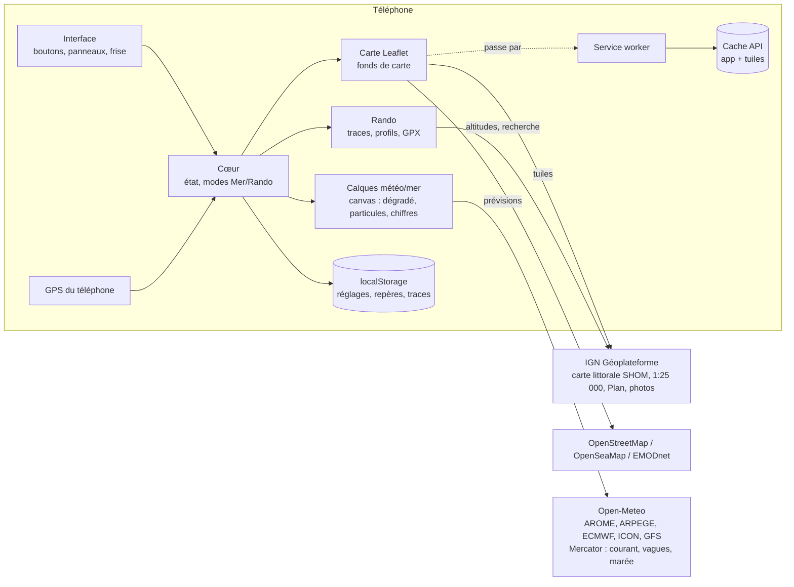
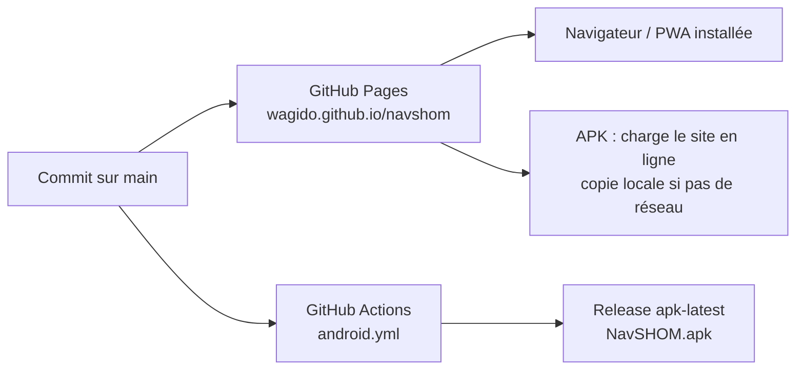

# Balise — Note d'architecture

> Anciennement « Nav SHOM ». Application de Capitaine BoBo.

> Statut : version 2026.11.14 · Auteur : Capitaine BoBo · Dernière mise à jour : 14 novembre 2026

## 1. Résumé

Balise est une application de navigation pour téléphone, avec deux modes :

- **Mer** : cartes marines SHOM (via la carte littorale IGN-SHOM), position GPS du bateau, courants, marée, vagues, météo marine, mesure de route, homme à la mer.
- **Rando** : cartes IGN au 1:25 000 sur toute la France, recherche de lieux, enregistrement de traces, profil altimétrique, import et export GPX.

C'est une **application web installable** (PWA) : un seul code HTML/JS, publié sur GitHub Pages, qui tourne dans le navigateur, s'installe sur l'écran d'accueil, ou s'emballe dans un **APK Android** (Capacitor). **Il n'y a pas de serveur à nous** : le téléphone interroge directement des services publics gratuits (IGN, Open-Meteo, EMODnet, OpenSeaMap).

## 2. Objectifs et contraintes

| Objectif | Conséquence technique |
|---|---|
| Gratuit, sans abonnement | Uniquement des données ouvertes ; aucun backend payant |
| Utilisable en mer sans réseau | Service worker + cache des tuiles + téléchargement de zone |
| Mise à jour sans repasser par un store | L'APK charge le site en ligne ; le site est la source unique |
| Un seul développeur, itérations rapides | Un seul fichier applicatif, aucune étape de build côté web |
| Respect des fournisseurs de données | Pas de contournement d'accès (refus d'usurper le *referer* SHOM) ; quotas Open-Meteo respectés |

## 3. Pile technique

| Couche | Choix | Pourquoi |
|---|---|---|
| Carte | **Leaflet 1.9.4** (embarqué dans `lib/`) | Léger, éprouvé, fonctionne hors ligne |
| Interface | HTML + CSS + JavaScript « vanilla » | Pas de framework, pas de build, démarrage instantané |
| Rendu météo | **Canvas 2D** (dégradé, particules, chiffres) | Fluide sur mobile, pas de dépendance |
| Police | **Inter** (embarquée, licence OFL) | Lisible, chiffres tabulaires, identique partout |
| Hors ligne | **Service worker** (`sw.js`) + Cache API | Standard web |
| Hébergement | **GitHub Pages** | Gratuit, HTTPS (obligatoire pour le GPS) |
| App Android | **Capacitor 6** (WebView) construit par **GitHub Actions** | APK sans installer Android Studio |

## 4. Organisation du dépôt

```
navshom/
├── index.html              # toute l'application (≈ 1 500 lignes : HTML, CSS, JS)
├── sw.js                   # service worker : cache de l'app et des tuiles
├── manifest.webmanifest    # métadonnées PWA (nom, icônes, couleurs)
├── icon.svg, icon-*.png    # icônes
├── lib/
│   ├── leaflet.js / .css   # bibliothèque de carte
│   ├── landmask.png        # masque terre/mer France (GLOBE ~1 km, 9 Ko)
│   └── fonts/              # police Inter (woff2) + licence
├── .github/workflows/
│   └── android.yml         # construction et publication de l'APK
└── docs/ARCHITECTURE.md    # ce document
```

Choix assumé : **un seul `index.html`**. À cette taille, c'est plus simple à déployer et à faire évoluer. Si l'app grossit, le découpage naturel suit les modules du §5.

## 5. Architecture applicative



### Modules (sections de `index.html`)

| Module | Rôle | Points clés |
|---|---|---|
| **Carte** | Fonds de carte, zoom, échelle | Un fond par mode, mémorisé ; bascule automatique si un fond ne répond pas |
| **GPS** | Position, vitesse, cap, trace du bateau | `watchPosition` ; vitesse/cap recalculés si le GPS ne les donne pas ; filtre anti-saut |
| **Point / repères / MOB** | Toucher la carte, repères, « Aller ici », homme à la mer | Distances en milles (Mer) ou km (Rando) |
| **Mesure** | Route multi-segments | Mer : milles + temps à vitesse donnée ; Rando : km + profil IGN + temps de marche (4 km/h + 300 m D+/h) |
| **Calques** | Vent, rafales, température, pression, pluie, nuages, visibilité, vagues, houle, courant | Grille de points → interpolation bilinéaire → dégradé continu (canvas) ; particules animées ; chiffres ; masque terre/mer pour les calques marins |
| **Frise et tableau** | Choix de l'heure, tableau heure par heure façon Windy | Curseur, boutons ±1 h/±3 h, tableau repliable synchronisé avec la carte |
| **Courant et marée** | Courbe au point touché | Marée lissée + PM/BM interpolées ; courant en barres colorées |
| **Météo** | Panneau prévisions 48 h + 7 jours | Choix du modèle ; comparaison des 5 modèles |
| **Rando** | Mode, recherche, traces, profils, GPX | Enregistrement repris après redémarrage de l'app ; altitudes IGN |
| **Hors ligne** | Téléchargement de zone | Tuiles du zoom courant à +3, limité à 4 000 tuiles |

### Rendu des calques (le cœur visuel)

1. `gridPts()` répartit 50 à 80 points sur l'écran.
2. **Une seule requête** Open-Meteo multi-points récupère 3 jours de prévisions horaires pour tous les points.
3. `buildGrid()` convertit l'heure choisie en grille écran (valeur + composantes u/v).
4. `drawField()` calcule chaque pixel (tous les 5 px) par interpolation bilinéaire, applique la palette continue et, pour les calques marins, le masque terre/mer, puis lisse l'image.
5. `startParticles()` anime environ 1 000 particules dans le champ u/v (vent, courant).
6. Le canvas est placé dans un *pane* Leaflet : il suit la carte pendant les déplacements, sous les marqueurs.

## 6. Sources de données

| Donnée | Fournisseur | Accès | Remarques |
|---|---|---|---|
| **Carte marine** (carte littorale) | IGN Géoplateforme, couche `GEOGRAPHICALGRIDSYSTEMS.COASTALMAPS` | Libre, sans clé | Cartes SHOM + IGN, zooms 6 à 16. « Non destinée à la navigation » |
| Carte IGN 1:25 000 | IGN, `GEOGRAPHICALGRIDSYSTEMS.MAPS` | Clé **transitoire** publique `ign_scan_ws` | Peut disparaître → bascule auto sur Plan IGN |
| Plan IGN, photos aériennes | IGN | Libre | |
| Altitudes | IGN, service altimétrie (RGE ALTI) | Libre | Profils et dénivelés |
| Recherche de lieux | IGN, géocodage (adresses + lieux-dits/sommets) | Libre | |
| Cartes SHOM directes | data.shom.fr | **Clé sous convention** | Prévu : champ « Ma clé SHOM » ; refus « Wrong referer » sans clé |
| Vent, météo | Open-Meteo (modèles Météo-France, ECMWF, DWD, NOAA) | Libre, non commercial | ≈ 10 000 points/jour/appareil |
| Courant, vagues, houle, hauteur d'eau | Open-Meteo Marine (Copernicus Mercator, MF-WAM…) | Libre | Maille ≈ 8 km ; courant marée incluse ; hauteur au niveau moyen |
| Balisage | OpenSeaMap | Libre | Surimpression optionnelle |
| Bathymétrie | EMODnet | Libre | Fond alternatif |
| Masque terre/mer | NOAA GLOBE via `global-land-mask` | Embarqué | Généré une fois en PNG 1 bit |

## 7. Données et stockage

| Où | Quoi | Durée |
|---|---|---|
| **Réseau (serveurs publics)** | Toutes les cartes et prévisions | — |
| **Cache API** (`navshom-tiles`) | Chaque tuile vue + zones téléchargées | Jusqu'à effacement des données de l'app |
| **Cache API** (`navshom-app-vN`) | Fichiers de l'app pour démarrer hors ligne | Remplacé à chaque version |
| **Mémoire** (30 min) | Réponses Open-Meteo et IGN déjà reçues | Session |
| **localStorage** (préfixe `nav_`) | Réglages, mode, vue, repères, MOB, trace du bateau, enregistrement en cours, traces rando, dernière météo | Permanent sur l'appareil |

**Les cartes ne sont pas embarquées dans l'app** : elles sont demandées en tuiles et mises en cache au fil de l'usage. Aucune donnée ne quitte le téléphone vers un serveur à nous : il n'y en a pas.

## 8. Distribution et mises à jour



- **Web / PWA** : chaque `git push` sur `main` publie le site. Le service worker (stratégie *réseau d'abord* pour l'app) récupère la nouvelle version au lancement suivant.
- **APK** : Capacitor charge `https://wagido.github.io/navshom/` (mises à jour automatiques) ; si le réseau manque, il affiche la copie embarquée (`errorPath`). Il ne faut réinstaller l'APK que si la partie native change, par exemple la taille de texte fixe (`MainActivity`).
- **Versionnement** : `APP_VERSION` (affichée dans le Menu) et nom du cache `navshom-app-vN` dans `sw.js`, à incrémenter ensemble à chaque publication.

## 9. Tests

- **Navigateur automatisé (Playwright)**, profils téléphone (Pixel 7) et grand écran : parcours carte, calques, frise, tableau, courbe, météo, mesure, mode Rando, import GPX ; vérification des erreurs JavaScript.
- **Données simulées** pour les cas hors réseau, **données réelles** une fois les hôtes autorisés.
- **Vérification des fonds de carte depuis le téléphone** : Menu → « Tester les fonds de carte ».

## 10. Limites connues et risques

| Sujet | Limite | Piste |
|---|---|---|
| Usage réglementaire | Pas une aide à la navigation certifiée ; carte littorale « non destinée à la navigation » | Mention affichée ; garder cartes officielles et veille |
| GPS écran éteint | Le WebView ne reçoit plus le GPS en veille → trace interrompue | Plugin natif de géolocalisation en arrière-plan |
| IGN 1:25 000 | Clé transitoire susceptible de fermer | Bascule auto sur Plan IGN ; clé personnelle IGN |
| Précision côtière | Courant/vagues à maille ≈ 8 km ; masque à ≈ 1 km | Données SHOM de courant si convention |
| Marée | Hauteur modélisée au niveau moyen, pas au zéro des cartes | Annuaire des marées SHOM (sous convention) |
| Quotas | Open-Meteo gratuit ≈ 10 000 points/jour/appareil | Grille réduite + cache 30 min ; offre payante si usage pro |
| Export GPX dans l'APK | Le WebView peut ignorer les téléchargements | Plugins Capacitor Share/Filesystem |
| iPhone | Pas d'APK ; PWA uniquement | Compte développeur Apple si app native voulue |

## 11. Feuille de route possible

1. Géolocalisation en arrière-plan (APK) pour les longues randonnées et nav de nuit.
2. Partage natif des GPX dans l'APK.
3. Routes enregistrables (waypoints nommés) et navigation vers un waypoint avec XTE.
4. AIS (trafic des navires) si une source ouverte convient.
5. Découpage de `index.html` en modules si l'équipe grandit.

## 12. Ajouts de la version 2026.11.14

- **Identité « Balise »** : icône (voyant de bouée cardinale = deux sommets), orange balise `#FF7A00`, bleu nuit `#0B2F5B`, vert sapin `#2E7D32` en Rando, page de démarrage.
- **Alarme de mouillage**, **routes et waypoints** (écart de route, heures d'arrivée), **sauvegarde/restauration** en un fichier JSON.
- **GPS en arrière-plan** dans l'APK : plugin `@capacitor-community/background-geolocation`, démarré seulement pendant une trace, un mouillage ou une route ; notifications (`@capacitor/local-notifications`), partage de fichiers (`@capacitor/filesystem`, `@capacitor/share`).
- **Marées officielles** : vignette publique du SHOM (60 ports) dans un cadre isolé (`data:`), le modèle Open-Meteo restant « indicatif ».
- **Rando** : itinéraires sur sentiers (service d'itinéraire IGN, profil piéton), carte des pentes IGN (`GEOGRAPHICALGRIDSYSTEMS.SLOPES.MOUNTAIN`), neige au sol, chute de neige, iso 0 °C, pente et exposition au point touché.
- **Panneau Cartes** par mode, avec aperçus.

## 13. Licences et attributions

Cartes © IGN / SHOM, © OpenStreetMap contributors, © OpenSeaMap, © EMODnet Bathymetry ; prévisions Open-Meteo (CC BY 4.0) ; Leaflet (BSD-2) ; police Inter (SIL OFL 1.1) ; masque GLOBE (NOAA, domaine public).
